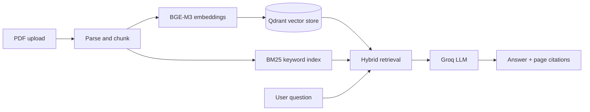

<div align="center">

# Docstore — RAG Application

**Answers hiding in your documents.**
Upload a PDF, build a private hybrid search index, and ask questions in plain language. Every answer is grounded in the source and traced back to the page it came from.

[](https://ragapplicationportfolio.streamlit.app/)


<sub>20-second walkthrough · <a href="assets/demo.mp4">Watch the full-quality video</a> · The document in the demo is a fictional sample.</sub>

</div>

---

## Overview

Docstore is a Retrieval-Augmented Generation (RAG) application that turns a PDF into a searchable, question-answering workspace. Instead of relying on keyword search or on an LLM's memory alone, it combines **semantic (dense) retrieval** with **keyword (BM25) retrieval**, then hands the best evidence to an LLM so answers stay tied to what the document actually says.

**Try it live:** [ragapplicationportfolio.streamlit.app](https://ragapplicationportfolio.streamlit.app/)

## Features

- **PDF ingestion**: upload a document and Docstore parses it and splits it into searchable chunks.
- **Hybrid retrieval**: BGE-M3 embeddings (vector search) plus BM25 (keyword search), so both meaning and exact terms are matched.
- **Grounded answers**: responses are generated from retrieved passages rather than from the model's guesswork.
- **Source and page citations**: each answer shows the source and page it was drawn from, e.g. `Source 01 · Page 04`.
- **Private session**: the index is built for your session and the workspace shows live stats (active source, searchable chunks, retrieval mode).
- **Fast inference**: answers are generated with an LLM served through Groq.

## How it works



1. **Parse and chunk**: the PDF is read with `pypdf` and split into chunks.
2. **Index**: chunks are embedded with BGE-M3 and stored in Qdrant, and a BM25 keyword index is built alongside.
3. **Retrieve**: a question is run against both indexes and the results are combined (hybrid mode).
4. **Generate**: the top passages are passed to the LLM on Groq, which writes an answer grounded in them.
5. **Cite**: the answer is returned with the source and page number it came from.

## Tech stack

| Layer | Tools |
|---|---|
| UI | Streamlit |
| Orchestration | LlamaIndex, LangChain text splitters |
| Embeddings | BGE-M3 (Hugging Face) |
| Vector store | Qdrant |
| Keyword retrieval | BM25 |
| LLM | Groq |
| PDF parsing | pypdf |

## Getting started

### Prerequisites

- Python 3.10+
- A [Groq API key](https://console.groq.com/keys)

### Installation

```bash
git clone https://github.com/Ahmed0469/RAG_application.git
cd RAG_application

python -m venv .venv
source .venv/bin/activate        # Windows: .venv\Scripts\activate

pip install -r requirements.txt
```

### Configuration

Set your Groq API key as an environment variable:

```bash
export GROQ_API_KEY="your_key_here"      # Windows (PowerShell): $env:GROQ_API_KEY="your_key_here"
```

When deploying on Streamlit Community Cloud, add the key under **App settings → Secrets** instead.

### Run

```bash
streamlit run src/streamlit_app.py
```

Then open the local URL Streamlit prints (usually `http://localhost:8501`), upload a PDF, wait for the **Hybrid index ready** badge, and start asking questions.

## Project structure

```
RAG_application/
├── src/                  # Application source code
├── .github/workflows/    # GitHub Actions automation
├── keep_alive.py         # Keeps the hosted demo awake
├── requirements.txt      # Python dependencies
└── assets/               # README media (demo GIF and video)
```

## Roadmap

- [ ] Multi-document workspaces
- [ ] Support for more file types (DOCX, TXT, web pages)
- [ ] Retrieval evaluation dashboard (hit rate, MRR, faithfulness)
- [ ] Re-ranking of retrieved passages

## Author

**Ahmed**: AI Engineer · Karachi, Pakistan
[Portfolio](https://ahmed0469.github.io/) · [GitHub](https://github.com/Ahmed0469) · [LinkedIn](https://www.linkedin.com/in/your-handle)

---

<div align="center"><sub>If you found this useful, consider giving the repo a ⭐</sub></div>
